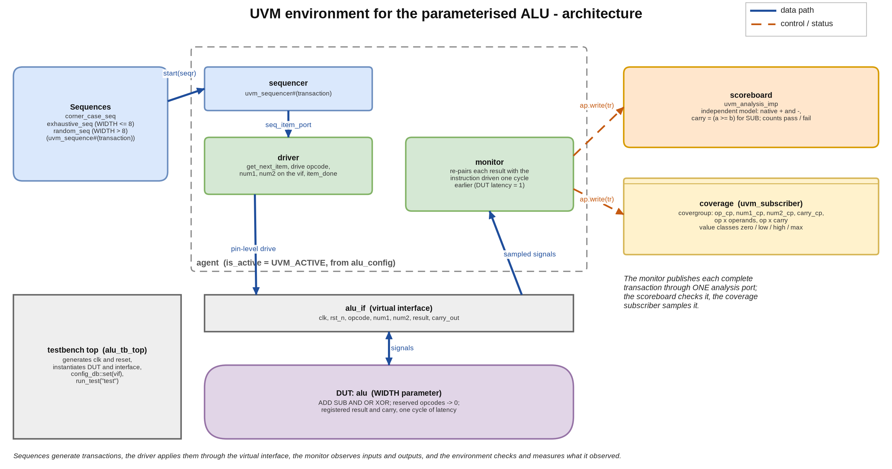
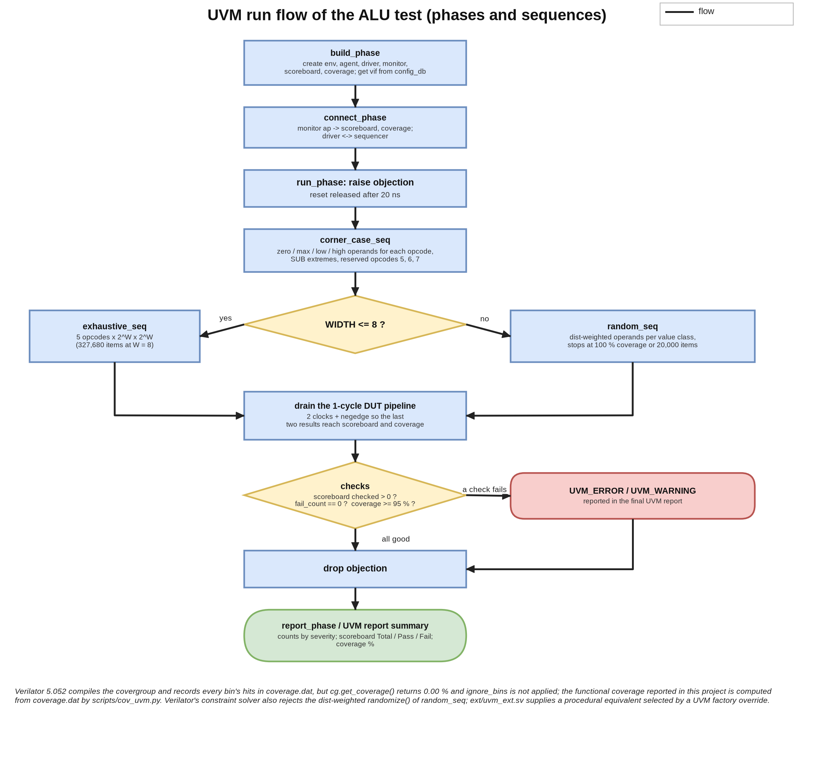
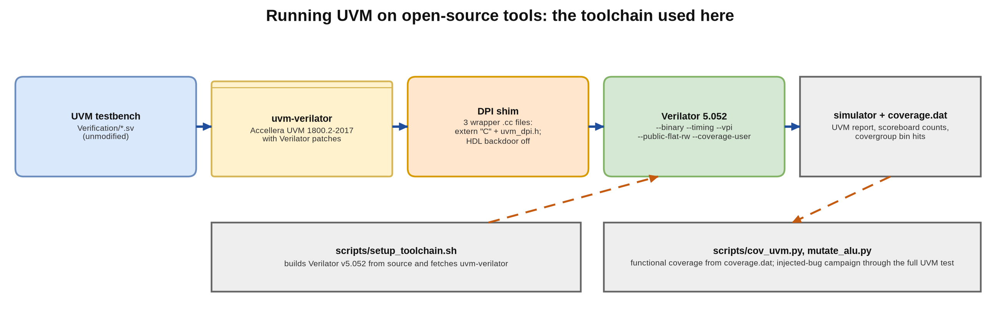

## A. Project overview

### A.1 Purpose

`alu_uvm_env` is a UVM 1.2-style verification environment for a small, parameterised ALU (ADD, SUB, AND, OR, XOR, with a registered
result and carry and an operand width set at compile time). It's a verification project. The design under test is tiny on purpose, so
that the environment itself (sequences, driver, monitor, scoreboard, covergroup, configuration) is what's being looked at.

The portfolio copy adds one thing the original didn't have: **it was run.** My original repository says the environment "was written and
reviewed without execution", because I had no UVM-capable simulator then. Here it's compiled and run with Verilator 5.052 and the
Accellera UVM library (the `uvm-verilator` kit), the scoreboard results and functional coverage are measured, and the environment is
checked with an injected-bug campaign.

### A.2 Problem statement and motivation

A verification environment is only believable once it has been shown to catch bugs. A scoreboard that never fails proves nothing, and a
covergroup that was never sampled reports nothing. So the aim was to take an environment that only existed on paper and give it
evidence: a run with real transaction counts, a coverage figure computed from real bin hits, and a measured answer to "which design bugs
would it miss?".

### A.3 Scope and requirements

| ID | Requirement | Status |
|---|---|---|
| R1 | Self-checking UVM environment: sequence, sequencer, driver, monitor, scoreboard, coverage subscriber, config object, virtual interface | implemented in the original; **executed** here |
| R2 | The scoreboard's reference model is independent of the DUT's implementation (it must not copy the shared-adder trick) | implemented (native `+`/`-`, carry = `a >= b`) |
| R3 | Correct handling of the DUT's one-cycle latency by re-pairing each result with the instruction that produced it | implemented (monitor) |
| R4 | Functional coverage: opcode, operand value classes, carry, opcode x operands, opcode x carry | implemented as a covergroup; measured from the simulator's bin data |
| R5 | Run at `WIDTH` 8 (exhaustive) and a wider width (random) | measured (8 and 16) |
| R6 | Show what the environment cannot catch | injected-bug campaign, with the gaps reported and one of them closed |

Out of scope: a UVM register model, multiple agents, random stimulus that relies on the constraint solver (see the tool limitations in
section G), and assertions on the DUT (the ALU is combinational logic plus one register, so the checks live in the scoreboard).

### A.4 Target application and concepts

It applies to any block with an input transaction and a registered output. Building it covers UVM phases and the factory,
`uvm_sequence` / `uvm_sequencer` / `uvm_driver`, virtual interfaces and the config DB, analysis ports and `uvm_subscriber`, independent
reference modelling, coverage-driven random stimulus, cross coverage and mutation analysis.

### A.5 Key features and measurable objectives

- Exhaustive verification at `WIDTH = 8`: 5 opcodes x 256 x 256 operand pairs = 327,680 transactions, plus directed corner cases.
- One analysis port that feeds both the scoreboard and the coverage subscriber.
- Objective: zero scoreboard failures, zero UVM errors, 100 % of the *counted* covergroup bins hit, and a measured list of the injected
  bugs that survive.

---

## B. Architecture and block diagram

### B.1 Overview

The testbench top (`alu_tb_top`) generates the clock and reset, instantiates the DUT and the interface `alu_if`, puts the virtual
interface in the config DB and calls `run_test("test")`. The test builds an `env` with an `agent` (sequencer, driver, monitor), a
`scoreboard` and a `coverage` subscriber, and starts the sequences on the agent's sequencer.

### B.2 Components and responsibilities

| Component | File | Responsibility |
|---|---|---|
| `transaction` | `transaction.sv` | `uvm_sequence_item`: `rand opcode`, `num1`, `num2`; result and carry filled by the monitor; constraint `legal_opcode` (the five opcodes) |
| sequences | `sequence.sv` | `corner_case_seq` (directed corners and reserved opcodes), `exhaustive_seq` (all pairs, `WIDTH <= 8`), `random_seq` (coverage-driven, `WIDTH > 8`) |
| `driver` | `driver.sv` | `get_next_item`, drives opcode/num1/num2 through the virtual interface on a clock edge, `item_done` |
| `monitor` | `monitor.sv` | samples the interface; pairs each result with the instruction driven one cycle earlier; ignores everything until one clock after reset is released; checks the output for X/Z |
| `scoreboard` | `scoreboard.sv` | `uvm_analysis_imp`; independent expected-value model; counts pass and fail; reports in `report_phase` |
| `coverage` | `coverage.sv` | `uvm_subscriber`; covergroup `cg` with `op_cp`, `num1_cp`, `num2_cp`, `carry_cp`, `op_x_operands`, `op_x_carry` |
| `agent`, `env`, `test`, `alu_config`, `alu_pkg`, `alu_if` | `agent.sv`, `env.sv`, `test.sv`, `config.sv`, `alu_pkg.sv`, `interface.sv` | structure, configuration (`is_active`), the `WIDTH` parameter and opcode constants, the signal bundle |

### B.3 Interfaces

`alu_if` carries `clk`, `rst_n`, `opcode[2:0]`, `num1[WIDTH-1:0]`, `num2[WIDTH-1:0]`, `result[WIDTH-1:0]` and `carry_out`. The DUT,
`alu #(WIDTH)`, has the same ports. There's one agent and one analysis port.

### B.4 Data and control paths

**Stimulus path**: sequence -> sequencer -> driver -> `alu_if` -> DUT. **Observation path**: DUT -> `alu_if` -> monitor -> analysis port
-> scoreboard and coverage. **Control**: the test raises the objection before the sequences and drops it after them, and the monitor
gates itself on reset.

---

## C. Draw.io architecture diagram



The diagram files are in `docs/portfolio/diagrams/`: `alu_uvm_architecture.drawio` (editable), `.png` and `.svg`, plus
`alu_uvm_flowchart.*` and `alu_uvm_toolchain.*`. `dgm.py`, next to the diagram script, draws them from the same specification that writes the `.drawio`, so
they aren't exports from draw.io.

---

## D. Design flowchart



The run starts with the UVM build and connect phases, raises an objection, runs `corner_case_seq`, and then runs either `exhaustive_seq`
(`WIDTH <= 8`) or `random_seq`. It then waits two clocks and a falling edge, so that the last two results reach the scoreboard and the
coverage subscriber (the DUT has one cycle of latency and the monitor publishes one cycle after that). Finally it checks that the
scoreboard saw transactions and no failures and that coverage meets the goal, drops the objection and prints the UVM report.



---

## E. Detailed design explanation

### E.1 The DUT

`alu #(WIDTH)` decodes opcode 000 as ADD, 001 SUB, 010 AND, 011 OR and 100 XOR; 101 to 111 are reserved and return 0 with carry 0. ADD
and SUB share one adder (`num2` is conditionally inverted and the subtract is fed in as carry-in). The result and carry are registered,
which gives one cycle of latency, with an asynchronous active-low reset.

### E.2 The latency problem and the monitor

The result lags the instruction by a cycle, so a monitor that sampled a single clock edge would pair each result with the *next*
instruction. Instead the monitor keeps the previous cycle's instruction and publishes a transaction made of that instruction and the
current result. It only sets `have_prev` after the first edge after reset and clears it while reset is asserted, so the first output,
which is the reset value, never becomes a transaction. It also checks the output for X/Z before the two-state transaction fields can
quietly turn it into 0.

### E.3 The scoreboard's reference model

The model deliberately does **not** reuse the DUT's shared-adder implementation. ADD is `{1'b0, a} + {1'b0, b}`, SUB is the native
subtraction with carry defined as `a >= b` (no borrow), the logic operations are bitwise, and reserved opcodes expect 0. So a bug in the
DUT's invert-and-carry-in trick can't be reproduced by the checker without anyone noticing.

### E.4 Coverage model

The value classes are relative to the width (`zero`, `max`, `low` = 1 to 2^(W-1)-1, `high` = 2^(W-1) to max-1), so the model stays
meaningful at any `WIDTH`. `op_cp` has bins for the five opcodes and a `reserved[]` bin set. `op_x_operands` crosses the opcode with both
operand classes and ignores the reserved opcodes, and `op_x_carry` crosses the opcode with the carry value and ignores AND, OR, XOR and
the reserved opcodes, whose carry is always 0.

### E.5 Reset, latency, throughput, back-pressure and errors

Reset is released after 20 ns. The DUT takes one instruction per clock with no handshake, so there's no back-pressure, and results come
one cycle late. Errors are reported with `uvm_error`, by the scoreboard for a mismatch and by the monitor for X/Z.

### E.6 Design decisions and trade-offs

| Decision | Alternative | Reason / cost |
|---|---|---|
| Exhaustive stimulus for `WIDTH <= 8` | random only | complete evidence for the exact configuration; does not scale beyond about 10 bits |
| Coverage-driven random above 8 bits | exhaustive | the only option at 16 bits and above |
| Independent reference model | reuse RTL expressions | catches bugs in the implementation trick |
| One analysis port for scoreboard and coverage | two monitors | one source of truth for what was observed |
| Original sources left unmodified; additions in `ext/` selected by factory override | edit the sources | the original remains exactly what was written; the additions are separable and documented |

---

## F. Interface and timing details

The interface is a plain synchronous bundle on `clk`. The driver changes `opcode`, `num1` and `num2` with non-blocking assignments after
a clock edge, the DUT registers its result on the following edge, and the monitor samples on every rising edge. A transaction is
therefore `(instruction at edge k, result at edge k+1)`. It supports any `WIDTH` that fits the packages (`alu_pkg::WIDTH`, default 8; the
run script rewrites it in a copy for other widths), one clock and synchronous stimulus.

---

## G. Verification and testing

### G.1 Execution evidence

```text
run             W sequence                   txns     pass  fail  UVM_ERROR  UVM_FATAL  wall [s]
------------------------------------------------------------------------------------------------
w8              8 exhaustive_seq           327705   327705     0          0          0    21.775
w16_original   16 random_seq (original)     20025    20025     0      20000          0     2.001
w16            16 random_seq_vl             20025    20025     0          0          0     0.998

simulator: Verilator 5.052 2026-09-05, one thread, seed 1; 'txns' = scoreboard Total (corner_case_seq 25 + main sequence).
note: the 'w16_original' run drives the unmodified random_seq; every one of its 20,000 randomize() calls fails on this simulator (UVM_ERROR),
      which is why the run is reported but not counted as a verification result (see section G.4).
```

### G.2 Functional coverage

Verilator 5.052 compiles the covergroup and records each bin's hit count in `coverage.dat`, but `get_coverage()` returns 0.00 % and
`ignore_bins` isn't applied. So `scripts/cov_uvm.py` reads the bin data and leaves out exactly the bins that `coverage.sv` declares
ignored.

WIDTH = 8 (exhaustive):

```text
coverpoint        bins ignored  counted    hit   zero
carry_cp             2      0        2      2      0
num1_cp              4      0        4      4      0
num2_cp              4      0        4      4      0
op_cp                8      0        8      8      0
op_x_carry          16     12        4      4      0
op_x_operands      128     48       80     80      0

raw (Verilator data as is, ignore_bins NOT applied) : 111 / 162 bins hit = 68.52 %
with the declared ignore_bins removed (60 bins)      : 102 / 102 bins hit = 100.00 %
counted bins never hit: none
```

WIDTH = 16 (20,000 procedurally generated random transactions plus the corner cases):

```text
coverpoint        bins ignored  counted    hit   zero
carry_cp             2      0        2      2      0
num1_cp              4      0        4      4      0
num2_cp              4      0        4      4      0
op_cp                8      0        8      8      0
op_x_carry          16     12        4      4      0
op_x_operands      128     48       80     80      0

raw (Verilator data as is, ignore_bins NOT applied) : 111 / 162 bins hit = 68.52 %
with the declared ignore_bins removed (60 bins)      : 102 / 102 bins hit = 100.00 %
counted bins never hit: none
```

### G.3 Checking the environment: injected bugs

Each of 14 one-line edits of the ALU is run through the complete UVM test at WIDTH = 8 (`scripts/mutate_alu.py`). With the original
sources:

```text
mutants run: 14, killed 10, survived 4
environment: ORIGINAL sources, unmodified
survivors are annotated: A07 is an equivalent mutant (OR does not use the adder, so its output cannot change); A08 and A14 change only the
reset value of a register, which this environment never samples (the monitor discards everything until one clock after reset is released): a gap, not an equivalent;
A06 (reserved opcodes return num1) survives the original environment because corner_case_seq sends reserved opcodes only with zero operands: a stimulus gap, closed by the extension.
PROBLEMS: none (every outcome matched its expectation)

A01  KILLED    SUB without the carry-in (a - b computed as a + ~b)            scoreboard fail  65542 of 327705, UVM_ERROR 65543   [expected: killed]
A02  KILLED    result LSB forced to 0 for ADD/SUB                             scoreboard fail  65542 of 327705, UVM_ERROR 65543   [expected: killed]
A03  KILLED    ADD/SUB carry taken from the wrong adder bit                   scoreboard fail  98308 of 327705, UVM_ERROR 98309   [expected: killed]
A04  KILLED    AND implemented as OR                                          scoreboard fail  65282 of 327705, UVM_ERROR 65283   [expected: killed]
A05  KILLED    XOR implemented as AND                                         scoreboard fail  65538 of 327705, UVM_ERROR 65539   [expected: killed]
A06  SURVIVED  reserved opcodes return num1 instead of 0                      scoreboard fail      0 of 327705, UVM_ERROR 0   [expected: gap]
A07  SURVIVED  subtract also asserted for OR (the adder is not used by OR)    scoreboard fail      0 of 327705, UVM_ERROR 0   [expected: equivalent]
A08  SURVIVED  result register resets to all-ones instead of 0                scoreboard fail      0 of 327705, UVM_ERROR 0   [expected: gap]
A09  KILLED    carry_out register stuck at 0                                  scoreboard fail  65541 of 327705, UVM_ERROR 65542   [expected: killed]
A10  KILLED    SUB carry has the wrong sense                                  scoreboard fail  65542 of 327705, UVM_ERROR 65543   [expected: killed]
A11  KILLED    OR implemented as XOR                                          scoreboard fail  58976 of 327705, UVM_ERROR 58977   [expected: killed]
A12  KILLED    XOR implemented as OR                                          scoreboard fail  58976 of 327705, UVM_ERROR 58977   [expected: killed]
A13  KILLED    operand 2 not inverted for SUB                                 scoreboard fail  65542 of 327705, UVM_ERROR 65543   [expected: killed]
A14  SURVIVED  carry_out register resets to 1                                 scoreboard fail      0 of 327705, UVM_ERROR 0   [expected: gap]
```

With the extension that closes the reserved-opcode gap (`ext/uvm_ext.sv`, a `corner_case_seq` subclass selected with
`+uvm_set_type_override`):

```text
mutants run: 14, killed 11, survived 3
environment: ORIGINAL sources + ext/uvm_ext.sv (corner-case extension)
survivors are annotated: A07 is an equivalent mutant (OR does not use the adder, so its output cannot change); A08 and A14 change only the
reset value of a register, which this environment never samples (the monitor discards everything until one clock after reset is released): a gap, not an equivalent;
A06 (reserved opcodes return num1) survives the original environment because corner_case_seq sends reserved opcodes only with zero operands: a stimulus gap, closed by the extension.
PROBLEMS: none (every outcome matched its expectation)

A01  KILLED    SUB without the carry-in (a - b computed as a + ~b)            scoreboard fail  65542 of 327723, UVM_ERROR 65543   [expected: killed]
A02  KILLED    result LSB forced to 0 for ADD/SUB                             scoreboard fail  65542 of 327723, UVM_ERROR 65543   [expected: killed]
A03  KILLED    ADD/SUB carry taken from the wrong adder bit                   scoreboard fail  98308 of 327723, UVM_ERROR 98309   [expected: killed]
A04  KILLED    AND implemented as OR                                          scoreboard fail  65282 of 327723, UVM_ERROR 65283   [expected: killed]
A05  KILLED    XOR implemented as AND                                         scoreboard fail  65538 of 327723, UVM_ERROR 65539   [expected: killed]
A06  KILLED    reserved opcodes return num1 instead of 0                      scoreboard fail     15 of 327723, UVM_ERROR 16   [expected: killed]
A07  SURVIVED  subtract also asserted for OR (the adder is not used by OR)    scoreboard fail      0 of 327723, UVM_ERROR 0   [expected: equivalent]
A08  SURVIVED  result register resets to all-ones instead of 0                scoreboard fail      0 of 327723, UVM_ERROR 0   [expected: gap]
A09  KILLED    carry_out register stuck at 0                                  scoreboard fail  65541 of 327723, UVM_ERROR 65542   [expected: killed]
A10  KILLED    SUB carry has the wrong sense                                  scoreboard fail  65542 of 327723, UVM_ERROR 65543   [expected: killed]
A11  KILLED    OR implemented as XOR                                          scoreboard fail  58976 of 327723, UVM_ERROR 58977   [expected: killed]
A12  KILLED    XOR implemented as OR                                          scoreboard fail  58976 of 327723, UVM_ERROR 58977   [expected: killed]
A13  KILLED    operand 2 not inverted for SUB                                 scoreboard fail  65542 of 327723, UVM_ERROR 65543   [expected: killed]
A14  SURVIVED  carry_out register resets to 1                                 scoreboard fail      0 of 327723, UVM_ERROR 0   [expected: gap]
```

The scoreboard catches every arithmetic and logic bug. Mutant A06 (reserved opcodes return `num1`) survives the original environment,
because `corner_case_seq` only drives the reserved opcodes **with zero operands**, where the buggy and correct outputs are the same. Only
the injected-bug campaign showed that stimulus gap, and the extension closes it. Mutants A08 and A14 (a register's reset value) survive
because the monitor ignores everything until one clock after reset is released, so the reset value is never observed. That's a known
blind spot rather than an equivalent mutant. A07 really is equivalent, because OR doesn't use the adder.

### G.4 Tool limitations met and how they were handled

| Limitation (Verilator 5.052) | Handling |
|---|---|
| `covergroup.get_coverage()` returns 0.00 % | coverage computed from `coverage.dat` by `cov_uvm.py` |
| `ignore_bins` not applied to the recorded bins | the script excludes the declared ignore bins and also prints the raw figure |
| the constraint solver rejects `dist` weights and a constraint over package parameters (`randomize()` returns 0) | `ext/uvm_ext.sv`: `random_seq_vl` (procedural operand classes and opcode table), selected by factory override |
| the stock `uvm_dpi.cc` needs a vendor HDL backdoor (`uvm_hdl.c`) | three small wrapper files (`scripts/dpi_wrappers/`) compile the command-line, regex and report helpers; HDL backdoor access is compiled off |
| the UVM test's coverage-goal check (`>= 95 %`) reads `get_coverage()` | a UVM_WARNING is printed; the real figure is in section G.2 |

### G.5 Simulation commands and tool requirements

```bash
scripts/setup_toolchain.sh                 # builds Verilator v5.052 + fetches uvm-verilator (one time)
scripts/run_uvm.sh build/w8                # WIDTH 8, exhaustive
scripts/run_uvm.sh build/w16 --width 16 --ext ext/uvm_ext.sv --plus +uvm_set_type_override=random_seq,random_seq_vl
python3 scripts/cov_uvm.py build/w8/coverage.dat
python3 scripts/mutate_alu.py [--with-ext]
```

### G.6 Known failures

None in the delivered runs: zero scoreboard failures and zero UVM_ERROR. The known gaps are that reset values aren't observed, that the
original random sequence can't run on this simulator (`random_seq_vl` replaces it), and that the test's 95 % coverage-goal check can't
work on this simulator.

---

## H. Synthesis, timing and performance results

This doesn't apply here. The project is a UVM environment around a small RTL block, and I didn't run synthesis, timing or power analysis
on the ALU, so those are **NOT MEASURED** (the `alu_fifo` and `rv32i_5stage_core` projects have synthesis and timing results for
ALU-class logic). For reference, the simulation speed (Verilator-reported, one thread, section G.1): the exhaustive WIDTH = 8 run of
327,705 transactions took 21.8 s of wall time, and the 20,025-transaction WIDTH = 16 run 1.0 s.

---

## I. Results, limitations and future improvements

### I.1 Summary

A UVM environment that had been written but never run now runs: 327,705 transactions at WIDTH 8 and 20,025 at WIDTH 16 with zero
failures, 100 % of the counted covergroup bins hit at both widths, and a measured injected-bug campaign that found one stimulus gap
(closed) and one blind spot (reset values).

### I.2 Most meaningful outcomes

1. Getting a real UVM library and covergroups to compile and run on open-source Verilator, with a setup script that reproduces it and a
   straight list of what the tool can't do.
2. A coverage figure computed from the raw bin data when the tool's own figure is wrong.
3. Mutation analysis of a *verification* environment, which found a concrete hole (reserved opcodes only tested at zero) that coverage
   alone didn't show, because the cross ignores reserved opcodes by design.

### I.3 Limitations

The open-source tool limits (section G.4); a tiny DUT; no assertions; no register model; no multi-agent topology; reset values aren't
observed; and the original `random_seq` can't run on this tool.

### I.4 Future improvements

SVA bound to the DUT (reset values, latency); a reset-value check in the monitor; formal equivalence of the ALU against a reference;
porting the environment to a commercial simulator to run `random_seq` with its constraint solver and the built-in coverage report; and a
second agent and scoreboard topology (for example an ALU behind a FIFO).

### I.5 Interview talking points

- How the monitor deals with a DUT that has one cycle of latency, and why it gates on reset.
- Why the scoreboard's model has to be independent of the RTL's structure.
- What `ignore_bins` does, why Verilator's raw coverage differs from the intended number, and how I got the right number back.
- How a mutant survived (reserved opcodes at zero operands) while coverage said 100 %, and what that says about coverage models.
- The factory override I used to add stimulus without changing the original sources.

---

## J. References and reproducibility

- IEEE 1800.2 (UVM); Accellera UVM; Antmicro `uvm-verilator`; Verilator manual (`--binary`, `--timing`, `--vpi`, `--coverage-user`).
- The original specification: `docs/superpowers/specs/2026-09-28-parameterized-alu-uvm-design.md` (the working plan I built the environment from isn't kept in this folder).
- Directory structure: `Design/alu.v`, `Verification/*.sv` (original, unmodified), `ext/uvm_ext.sv`, `scripts/` (`setup_toolchain.sh`,
  `run_uvm.sh`, `cov_uvm.py`, `mutate_alu.py`, `dpi_wrappers/`), `results/`, `docs/portfolio/`.
- To reproduce, use the commands in section G.5. The toolchain directory (`../../_toolchain`) isn't part of the deliverable;
  `setup_toolchain.sh` recreates it. The source is at https://github.com/AbhijeetJ-512/alu-uvm-env.
